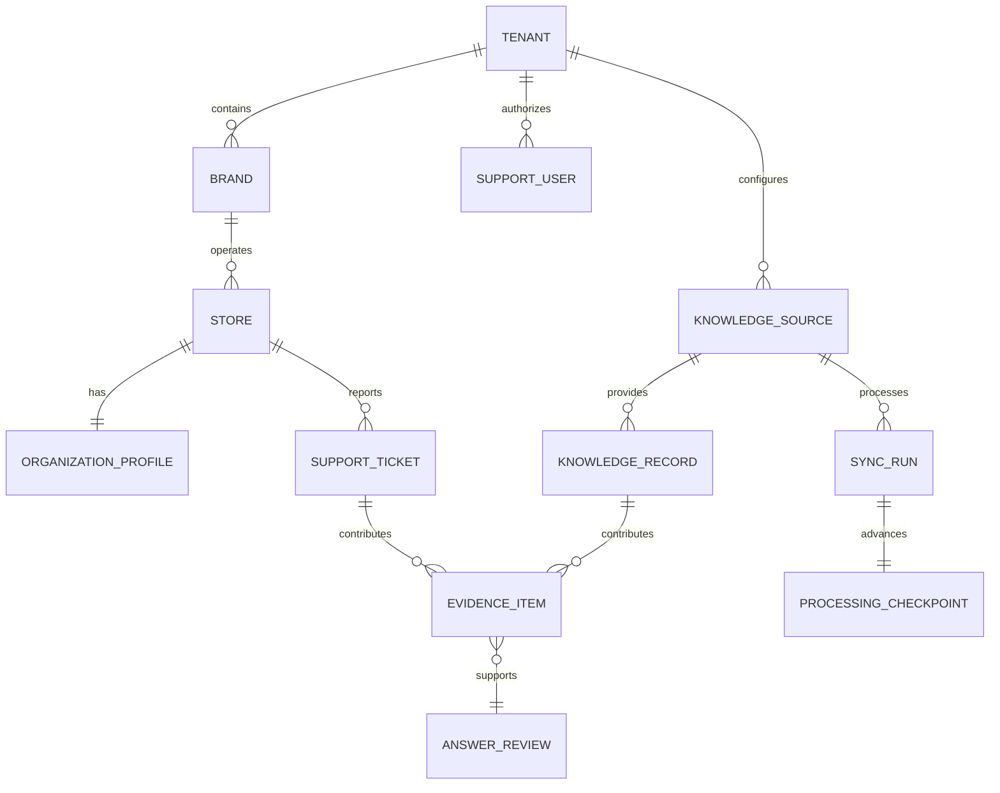

# Domain model and API conventions

ESIP models support work around a tenant, its operating locations, the people handling support, and
the evidence attached to each ticket. These terms are used in the API, frontend, tests, and sample
data.

## Core entities

| Entity | Meaning |
|---|---|
| Tenant | The operating company whose users, stores, tickets, knowledge, and configuration are isolated in ESIP. |
| Brand | An operating concept owned by a tenant. One brand has many stores. |
| Store | A supported location with a stable identifier and one organization profile. |
| Organization profile | Store metadata used during investigation: brand, systems, contacts, and operational attributes. |
| Support user | An authenticated engineer, administrator, or super administrator. |
| Support ticket | A reported issue with requester context, comments, attachments, status, ownership, SLA state, and resolution. |
| Knowledge source | A configured article or document origin with its own enablement and sync state. |
| Knowledge record | A searchable document or article returned with source identity, URL, and freshness data. |
| Evidence item | Ticket, knowledge, or analytics material used to support an answer. |
| Sync run | One bounded ingestion execution for new or changed records from a configured source. |
| Processing checkpoint | Durable progress that lets an interrupted run continue after its last completed unit of work. |
| Answer review | A structured assessment of correctness, evidence support, scope, and repair eligibility. |
| Knowledge gap | A recurring support need for which current documentation is missing, incomplete, stale, conflicting, or difficult to find. |

## Relationships

## Identifier rules

- Ticket IDs are decimal identifiers. The included dataset uses `950001` through `950240`.
- Store IDs are four digits. The included dataset uses `2001` through `2060`.
- A bare four-digit search value is treated as a store. Prefix a four-digit ticket with `#`.
- Source and run identifiers are stable strings suitable for URLs, logs, and checkpoints.
- User identities are email addresses; roles and authorization are still resolved server-side.

## HTTP conventions

The API is rooted at `/api`. JSON is used for requests and responses except report exports, which
return PDF or XLSX content.

| Route group | Responsibility |
|---|---|
| `/api/auth` | Session identity, role, and access state |
| `/api/tickets` | Ticket, store, history, comments, and assigned-ticket queries |
| `/api/ai` | Ticket summaries, related cases, knowledge suggestions, and customer-risk signals |
| `/api/universal` | General and ticket-scoped chat orchestration |
| `/api/analytics` | Read-only operational analysis and result tables |
| `/api/docs-gap` | Knowledge-gap analysis, saved runs, findings, and drafts |
| `/api/admin` | Users, sources, jobs, cost, quality, impact, reports, and protected controls |
| `/api/zaf` | Short-lived authentication exchange for the embedded Zendesk application |
| `/api/telemetry` | Bounded interaction and outcome events |

`GET /health` is unauthenticated and returns `{ "status": "ok" }`. Interactive API documentation is
available at `/docs` in local development.

## Evidence contract

Every retrieved item identifies its source and keeps the fields needed for review: ticket number,
document URL, result row, store, date range, or query scope. An answer must not widen those boundaries
silently. If evidence is partial or a tool fails, the response carries that state instead of presenting
the result as complete.

The same contract supports follow-up questions. A follow-up can narrow a previous result set, but it
cannot substitute a different store, date window, or source unless the user asks for that change.

## Included dataset

The Northstar sample tenant contains 12 brands, 60 stores, 60 organization profiles, 12 support users,
and 240 tickets. Relationships and timestamps are deterministic so tests, screenshots, and walkthroughs
reproduce the same state.
