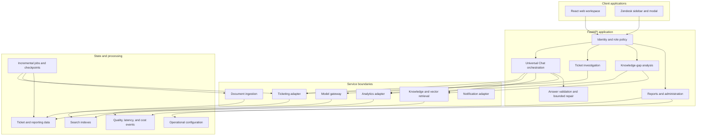

# ESIP architecture

ESIP separates user interaction, domain policy, provider access, and background processing. The
browser clients never call data or AI providers directly. FastAPI owns authentication, authorization,
scope resolution, tool selection, result normalization, and telemetry.

## System map

## Request path

1. The API resolves the authenticated user and role within the configured organization.
2. Scope parsing extracts ticket IDs, store IDs, dates, brands, and references to earlier results.
3. Policy selects the allowed ticket, knowledge, structured-document, or analytics tools.
4. Adapters return typed result sets with source identity and provenance.
5. The response layer builds an answer from those results.
6. Validation checks scope retention, citations, ticket references, unsupported claims, and tool errors.
7. A bounded repair may run when the failure type is eligible. The original evidence remains fixed.
8. The API records route, latency, quality, and cost metadata for review.

Ticket-specific and general conversations have separate histories. Opening a ticket does not silently
change the active conversation; the question must refer to that ticket before its context is used.

## Runtime profiles

`RUNTIME_PROFILE=reference` is the default. It supplies deterministic identities, tickets, knowledge,
analytics, reports, jobs, and administrative state from local services. Mutations live for the life of
the API process and reset on restart.

`RUNTIME_PROFILE=connected` enables configured provider adapters. Authentication and authorization
remain server-side. Credentials are read from the runtime environment, not from either client.

The profiles share HTTP contracts. Reference branches in the routers return local responses before
provider work begins. This makes interface testing reproducible, but does not exercise model
reasoning, cloud permissions, provider failure recovery, or arbitrary follow-up semantics.

## Data and processing

The connected architecture uses BigQuery for ticket analytics, Firestore for operational settings and
checkpoints, object storage for generated reports, and search indexes for knowledge and similar-ticket
retrieval. The reference runtime supplies local route responses instead of emulating each cloud service.

Ticket and document ingestion is incremental. Each run records source, trigger, start time, completion
state, checkpoint, counts, and errors. A partial run stays visible as partial. Checkpoints advance only
after the associated work is complete.

OCR and embedding work has explicit batch limits and cost gates. Failed attachments retain their last
known state rather than entering an automatic retry loop.

## AI controls

Model calls use named route profiles. Each profile defines the model family, output limit, thinking
control, timeout, retry count, safety settings, and eligible tools. Unknown combinations fail before a
provider request is sent.

The model does not receive unrestricted databases or credentials. Tools return bounded evidence, and
the final answer keeps links and identifiers that let an engineer verify the result. Quality telemetry
records structured outcomes instead of full prompts by default.

## Access model

- Support engineers can investigate tickets, use chat, search knowledge, and view announcements.
- Administrators can manage routine users, sources, reports, notifications, and operational controls.
- Super administrators can manage protected model and platform controls and preview lower-access roles.

Role checks run in the API. Client-side navigation only changes what is visible; it does not grant
access.

## Deployment shape

The repository includes containers for the FastAPI service and background jobs, a static React build,
and a Zendesk application bundle. The intended hosted shape uses Cloud Run, Cloud Run jobs, Cloud
Scheduler, Firebase Hosting, BigQuery, Firestore, object storage, and Vertex AI services.

Local development needs none of those services. See [SETUP.md](SETUP.md).

## Source map and tradeoffs

| Concern | Implementation | What to inspect |
|---|---|---|
| Local evaluation | [reference runtime](backend/app/services/reference_runtime.py), [fixtures](backend/app/reference_data/fixtures.py) | Linked tickets and stores, process-local state, deterministic response examples |
| Identity and roles | [dependencies](backend/app/dependencies.py) | Server-side role checks and the separate local session path |
| Chat orchestration | [router](backend/app/routers/universal.py), [policy](backend/app/services/chat_policy.py) | Scope resolution, tool selection, evidence assembly, and streaming |
| Answer review | [validator](backend/app/services/chat_answer_validator.py), [repair loop](backend/app/services/chat_repair_loop.py) | Failure classification and limits on automatic repair |
| Failure metadata | [provenance](backend/app/services/error_provenance.py) | Allowlisted categories instead of raw upstream error text |
| Verification | [reference contracts](backend/test_reference_runtime.py), [CI](.github/workflows/ci.yml) | Credential-free routes, exports, mutations, and client checks |

The local runtime favors repeatable evaluation over persistence and realistic model behavior. The
connected implementation uses explicit routing rules to make scope decisions inspectable, at the cost
of a large chat router. That router and the admin panel are the main decomposition opportunities;
changing their boundaries requires integration coverage rather than a cosmetic file split.

Multilingual parsing expressions and regression inputs are intentional. Documentation and developer
commentary are in English.

## Connected-profile limits

- Model calls still use `vertexai.generative_models`. Google has deprecated that module; a connected
  deployment needs migration to the Google Gen AI SDK and fresh provider checks. See the
  [migration guide](https://docs.cloud.google.com/vertex-ai/generative-ai/docs/deprecations/genai-vertexai-sdk).
- The Zendesk client uses configured email/token authentication and example field mappings. OAuth
  renewal, real organization schemas, and account permissions need deployment-specific work.
- The data model describes one configured organization. This repository does not demonstrate shared
  multi-tenant storage isolation.
- Reference answers and analytics are canned or keyword-selected. A successful local run does not
  establish answer quality, live retrieval accuracy, or production resilience.
- Cloud deployment scripts retain environment assumptions. The split-image deploy helper requires
  Cloud Build configuration files that are not included. No hosted deployment is provided or tested
  by CI. Use the local setup for evaluation.
