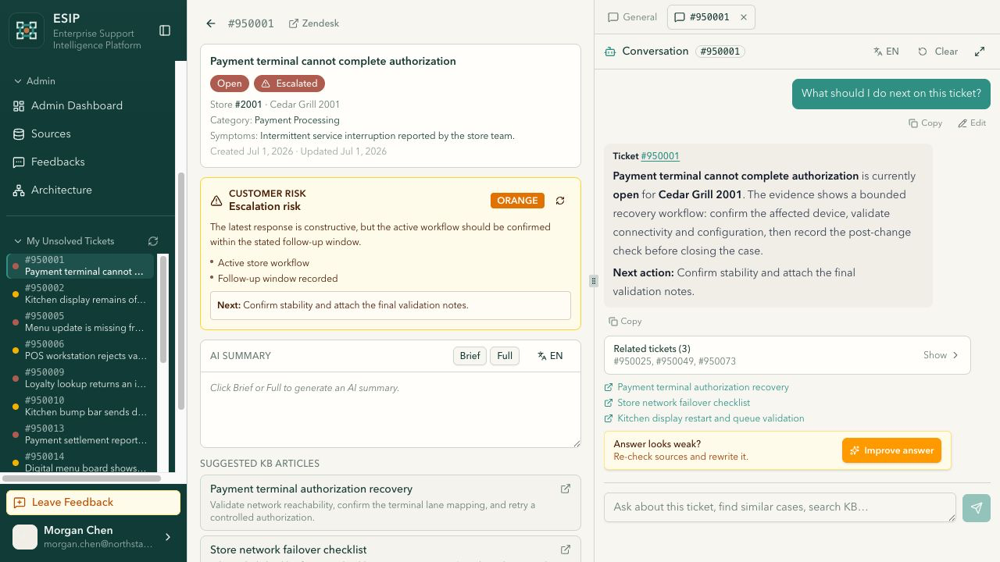
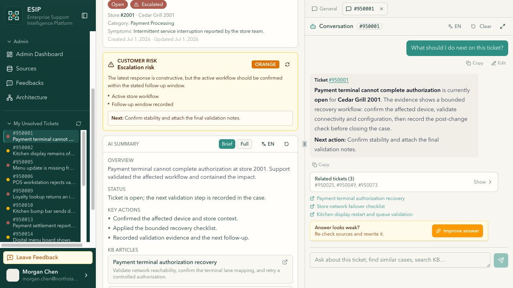
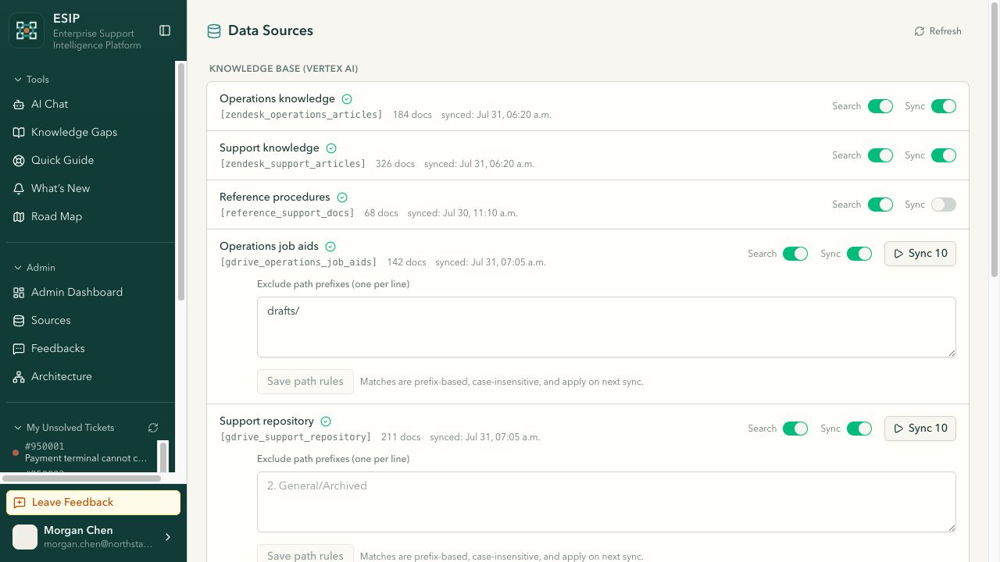
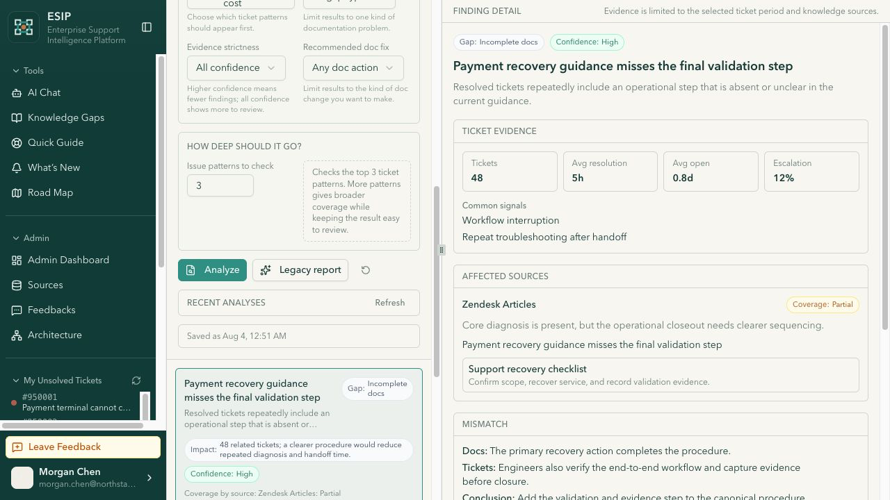
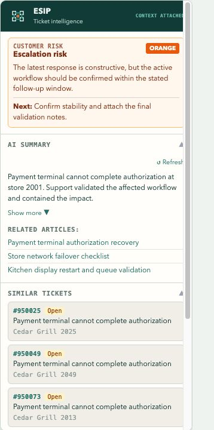
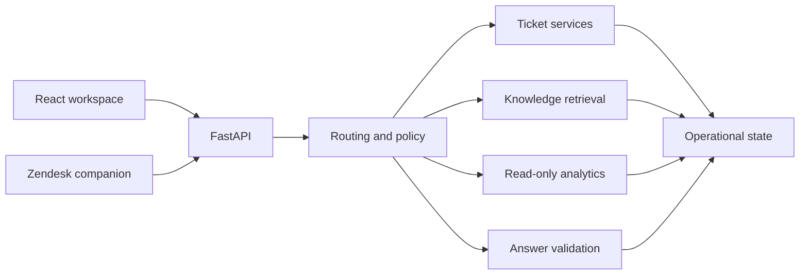

# ESIP

**Enterprise Support Intelligence Platform**

ESIP gives support engineers one place to investigate tickets, search operating knowledge, compare
past resolutions, ask scoped questions, and measure service performance. The same platform includes
the controls needed to run those workflows responsibly: source health, cost limits, role management,
quality telemetry, scheduled jobs, and resumable processing.



## What the platform covers

| Workspace | What happens there |
|---|---|
| Ticket investigation | Search by ticket or store, read the full timeline, generate summaries, inspect customer risk, and open related cases. |
| Universal Chat | Ask across tickets, knowledge, and analytics while retaining ticket, store, date, and result-set scope. |
| Knowledge intelligence | Search maintained sources, compare documentation with recurring issues, and prepare reviewable article drafts. |
| Ticket analytics | Turn supported operational questions into read-only queries, tables, charts, and linked evidence. |
| Administration | Manage users, sources, jobs, notifications, spend, quality, impact, and protected model controls. |
| Embedded support panel | Work from the active Zendesk ticket in a 320 px sidebar, then open the full workspace with its context intact. |

The included Northstar workspace contains 12 brands, 60 stores, 12 users, and 240 linked tickets.
It runs locally with no cloud account and produces the same records on every start.

## Screens

| Support workflow | Operations and governance |
|---|---|
|  |  |
|  |  |

## Engineering shape

ESIP is split into three applications and a set of provider adapters:

- a React 19 workspace for ticket operations, chat, analytics, and administration;
- a FastAPI service for domain policy, orchestration, exports, and integration boundaries;
- a React 18 Zendesk application for sidebar and modal workflows;
- BigQuery, Firestore, Vertex AI Search, Zendesk, Google Drive, Gemini, email, and contact-centre adapters
  selected through an explicit runtime profile.

The local `reference` profile replaces external adapters with deterministic in-process services. The
`connected` profile keeps the same API contracts and enables configured providers.



The answer pipeline carries structured evidence between tools. It validates scope, citations, ticket
references, and unsupported claims before a response is returned. Background work is incremental and
checkpointed, so an interrupted run can continue without repeating completed OCR, embedding, or sync
steps.

Read [the architecture notes](ESIP_OVERVIEW.md) for the full service map.

## Run it locally

Requirements: Python 3.12, Node.js 20.19+ or 22.12+, and npm 10+.

```bash
cp .env.example .env

python3 -m venv .venv
source .venv/bin/activate
python -m pip install -r backend/requirements.txt

cd backend
uvicorn app.main:app --reload --port 8000
```

In a second terminal:

```bash
cd frontend
npm ci
npm run dev
```

Open `http://localhost:3000` and select **Open reference workspace**. No provider credentials are
needed for the reference profile.

Detailed commands are in [SETUP.md](SETUP.md). A guided product tour is in
[WALKTHROUGH.md](WALKTHROUGH.md).

## Verification baseline

- Backend: 617 tests pass, plus 51 parameterized subtests.
- Reference runtime: 15 contract tests cover the primary page matrix, exports, local mutations,
  companion authentication, and forbidden network access.
- Web application: lint and production build pass.
- Zendesk application: type-check and production build pass at a 320 x 720 viewport.

Run the checks:

```bash
python -m pip install pytest
python -m pytest -q -p no:cacheprovider backend

(cd frontend && npm ci && npm run lint && npm run build)
(cd zendesk-app && npm ci && npm run type-check && npm run build)
```

## Documentation

- [Architecture and request flow](ESIP_OVERVIEW.md)
- [Local setup and runtime profiles](SETUP.md)
- [Product walkthrough](WALKTHROUGH.md)
- [Domain model and API conventions](CONTEXT.md)
- [Product requirements and limits](PRD.md)
- [Security reporting](SECURITY.md)
- [Third-party notices](THIRD_PARTY_NOTICES.md)

## Source terms

This code is available for viewing only. It is not open source. Copying, modification, distribution,
sublicensing, deployment, or commercial use requires written permission from the copyright holder.
No additional rights are granted by making the source visible.
